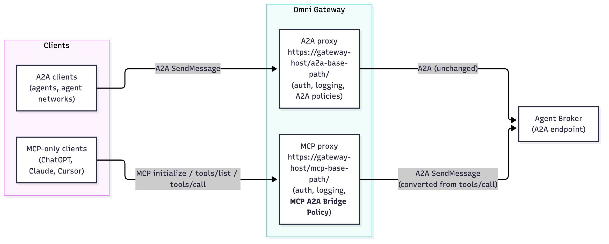
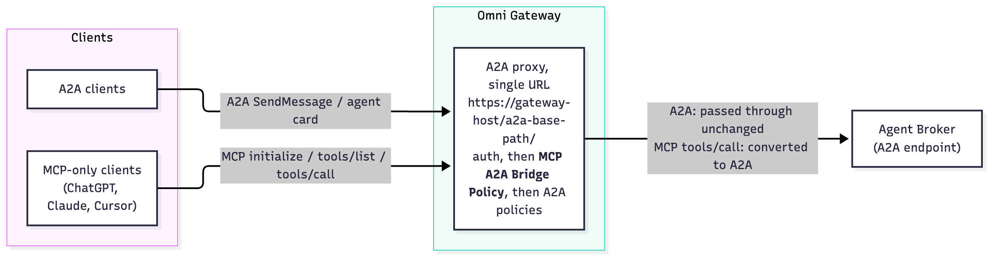

# MCP to A2A: Connect Any AI Assistant to Your Agent Broker

Your teams have built an agent network that answers real business questions. Now your employees want to ask those questions from the AI assistant they already use every day. The catch is that the assistant and the agent network speak different languages.

This article shows how a single gateway policy closes that gap. You'll learn what problem it solves, how it works at a high level, and the two ways you can deploy it.

**Terms used in this article**

- **MCP (Model Context Protocol):** An open standard that lets AI assistants discover and call external tools.
- **A2A (Agent2Agent protocol):** An open standard that lets AI agents send tasks and messages to each other.
- **Agent broker:** A MuleSoft component that routes each request to the right agent in an agent network.
- **API proxy:** An endpoint on the gateway that applies policies, such as security, before forwarding traffic.

## Why AI assistants can't reach your A2A agent broker

[Agent brokers in MuleSoft Agent Fabric](https://docs.mulesoft.com/general/learning-map-agent-fabric) speak the [A2A protocol](https://a2a-protocol.org/latest/). A2A is built for agents that hand work to other agents. It uses tasks, messages, and a shared conversation ID to keep track of each exchange.

Many popular AI assistants speak a different standard. ChatGPT, Claude, and Cursor connect to outside systems through the [Model Context Protocol](https://modelcontextprotocol.io/). They expect a list of tools they can call, not an agent they can message.

So your HR or IT agent network works well for other agents. But it stays out of reach for the assistants your people actually open. Without a bridge, every team that wants that connection has to build and run its own wrapper service.

Each wrapper adds code to maintain, another place to secure, and another service to monitor. Multiply that by every agent network, and the cost adds up fast.

## What the MCP A2A bridge policy does

The MCP A2A bridge policy is a custom policy for MuleSoft Omni Gateway (Flex Gateway). It makes your agent broker look like an MCP server, with no change to the broker itself.

To an AI assistant, the broker now offers one simple tool, such as "ask the HR agent." The assistant calls that tool with a plain-language question. The policy turns the call into an A2A message, sends it to the broker, and turns the answer back into a tool result.

Because the translation happens in the gateway, it sits next to the policies you already trust. You keep the same authentication, logging, rate limiting, and analytics. You don't deploy or run a new service.

### How the policy keeps conversations going

Real questions often come in a series. "Who is Jane Doe's manager?" is often followed by "What is her manager's email?"

Every answer the policy returns includes the broker's conversation ID. The assistant passes that ID back on the next question, so the broker knows it belongs to the same conversation. If the broker needs more detail before it can answer, the assistant replies within the same task.

You guide this behavior with the tool description you set in the policy. Tell the assistant what the agent network covers and when to reuse the conversation ID. Good descriptions lead to better answers.

## Two ways to deploy the MCP A2A bridge policy

You can apply the policy in one of two modes. Both use the same policy version, and both forward traffic to the same agent broker.

### Mode 1: a dedicated MCP proxy next to your A2A proxy

In this mode, your agent broker keeps its existing A2A proxy for agent traffic. You create a second API proxy of type MCP that points to the same broker. You apply the bridge policy only to the MCP proxy.

A2A clients keep using the A2A URL. AI assistants, such as ChatGPT, use the new MCP URL. Each proxy forwards requests to the broker through its own set of policies.

*Image caption: Mode 1. A2A clients use the A2A proxy, and AI assistants use an MCP proxy with the bridge policy.*

Choose this mode when you want clear separation. You get distinct URLs, contracts, security settings, and analytics for agent traffic and assistant traffic. This is the recommended starting point.

### Mode 2: one proxy for A2A and MCP clients

In this mode, only the agent broker's A2A proxy exists. You apply the bridge policy directly to it and turn on its pass-through setting.

Now one URL serves both kinds of clients. When an AI assistant sends an MCP request, the policy answers it or translates it. When an agent sends a native A2A request, the policy passes it to the broker unchanged.

*Image caption: Mode 2. One A2A proxy with the bridge policy serves both A2A clients and AI assistants on the same URL.*

Choose this mode when you want a single endpoint for everyone, or when you can't add a second proxy. Place the bridge policy after your authentication policies so that every request is checked first.

### Which mode should you choose?

| | Mode 1: dedicated MCP proxy | Mode 2: one shared proxy |
|---|---|---|
| Endpoints to share | One for agents, one for AI assistants | One for everyone |
| Separate policies and analytics | Yes | Shared |
| Changes to the existing A2A proxy | None | Add the bridge policy |
| Best for | Production rollouts with clear ownership | Quick setups and single-endpoint needs |

## Getting started with the bridge policy

The bridge policy is a custom policy built with the [Flex Gateway Policy Development Kit](https://docs.mulesoft.com/pdk/latest/) (PDK). You publish it to Anypoint Exchange once. After that, it appears in API Manager for both MCP and A2A API instances.

From there, getting started takes four steps:

1. **Pick your mode.** Decide whether you want a dedicated MCP proxy or one shared proxy.
2. **Apply the policy.** Add it in API Manager, after your authentication policies.
3. **Describe your tool.** Write a clear tool name and description that tell the assistant what your agent network can answer.
4. **Secure the endpoint.** Many AI assistants can't send custom headers, so protect the endpoint with OAuth 2.0 from the [included gateway policies](https://docs.mulesoft.com/gateway/latest/policies-included-directory).

Then connect your AI assistant to the endpoint URL and ask your first question.

## Open your agent network to every AI assistant

Your agent network is only as valuable as the people who can reach it. The MCP A2A bridge policy lets AI assistants and other agents use the same agent broker. You don't need to rebuild the broker or run another service.

Start with one agent network and one assistant. Measure how your people use it, then roll it out to the rest of your agent networks.

Learn more about building your own gateway policies in the [PDK custom policy documentation](https://docs.mulesoft.com/gateway/latest/policies-custom-flex-getting-started).
