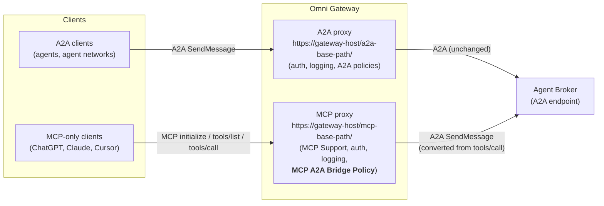
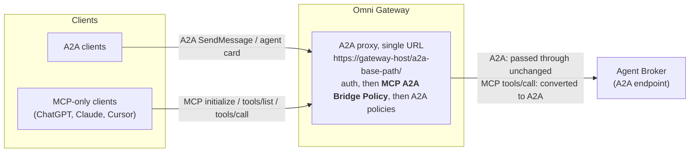

# MCP A2A Bridge Policy

A custom Omni Gateway (Flex Gateway) policy that lets MCP clients use an A2A agent, such as a MuleSoft Agent Broker, as if it were an MCP server with one tool.

| | |
|---|---|
| Exchange asset | `mcp-a2a-bridge-policy` (definition), `mcp-atoa-bridge-policy-flex` (implementation) |
| Current version | 1.3.3 |
| Category | Transformation |
| Applies to API instance types | MCP, A2A (v0.3), A2A (v1.0) |
| Gateway | Omni Gateway / Flex Gateway (managed or self-managed), **1.11.0 or later** for policy 1.1.0 and later |

---

## 1. Purpose

The policy puts an MCP front on an A2A agent. The agent can be a single A2A agent or an agent broker such as MuleSoft Agent Broker; this guide says "broker" for either. MCP clients see one tool (`ask_agent` by default), call it with a natural-language message, and get the agent's answer back as an ordinary MCP tool result. The agent needs no changes.

It is a **single-tool adapter**, not a full or lossless MCP↔A2A protocol translation. Each `tools/call` becomes one A2A `SendMessage`, and the policy returns the final or interrupted result. Polling, cancel, push notifications, streaming delivery and authentication flows are not mapped, MCP elicitation is an experimental opt-in (3.2), and some artifact detail is flattened. Read [section 8, Limitations](#8-limitations) before relying on it.

## 2. Problem statement

- **Agent brokers speak only A2A.** A MuleSoft Agent Broker accepts A2A requests (`SendMessage`, tasks, agent card).
- **Many AI clients speak only MCP.** ChatGPT, Claude, Cursor and Copilot connect to MCP servers. They can't call an A2A endpoint.
- **The two protocols differ.** They use different messages, different conversation handling (A2A context and task IDs versus MCP tool calls), and different response shapes.

Without the policy, every team that wants these clients to reach the broker has to build and run its own MCP wrapper service. The policy does the conversion inside the gateway instead, alongside the existing security, logging and rate-limiting policies, and needs no extra service.

## 3. How it works

| MCP client sends | Policy does |
|---|---|
| `initialize`, `ping`, `tools/list`, notifications | Answers them at the gateway; nothing reaches the broker |
| `tools/call` for `ask_agent` | Converts the call into an A2A `SendMessage`, forwards it to the broker, and converts the A2A reply back into an MCP tool result |
| Native A2A request (Mode 2 only): JSON-RPC (v1.0 or v0.3), HTTP+JSON (`/message:send`, `/tasks/{id}:cancel`, ...), agent card, gRPC | Forwards it to the broker unchanged: same path, headers and body |

**Multi-turn conversations.** Every tool result returns the broker's `state`, and its `contextId` and `taskId` when the broker sent them.
- To **continue a conversation**, the client passes `context_id` back.
- To **answer a question the broker asked** (state `input-required`), the client passes `task_id`, plus `context_id` when one was returned. A2A v1.0 lets an agent omit the context ID, so `task_id` alone is valid.
- **`auth-required`** means the broker needs authorization that the user must complete outside the conversation, as the broker describes. Replying to the tool doesn't grant it, and the client must never send passwords, tokens or other secrets in `message`. Once it is done, the client calls the tool again with the same IDs.

The tool result text always says what to do next, even with `includeStructuredContent: false`.

### 3.1 Client-managed follow-up questions

This is the default, and the mode to use with ChatGPT. The policy never asks the user anything itself: it doesn't send MCP `elicitation/create` or any other server-to-client request, and it never resubmits a task on its own. The MCP client owns the conversation. It shows the broker's question to the user, collects the answer, and calls the tool again with the IDs.

1. The client calls the tool:
   ```json
   {"jsonrpc":"2.0","id":1,"method":"tools/call",
    "params":{"name":"ask_agent","arguments":{"message":"Pay the electricity bill"}}}
   ```
2. The broker needs more input. The policy returns the question, the state and the continuation:
   ```json
   {"jsonrpc":"2.0","id":1,"result":{
     "content":[
       {"type":"text","text":"Which account should I use?"},
       {"type":"text","text":"[a2a state=input-required] The agent is waiting for your reply. Call ask_agent again with task_id=\"t9\"."}],
     "structuredContent":{"state":"input-required","taskId":"t9"},
     "isError":false}}
   ```
   In this example the broker sent no `contextId`. When it does, the hint and `structuredContent` include it, and the client passes it back too.
3. The client asks the user, then sends the answer to the same task:
   ```json
   {"jsonrpc":"2.0","id":2,"method":"tools/call",
    "params":{"name":"ask_agent","arguments":{"message":"The checking account","task_id":"t9"}}}
   ```
4. The broker continues task `t9` and the policy returns its next result: `completed`, or another `input-required` that the client handles the same way.

### 3.2 Experimental: MCP elicitation (`enableElicitation`)

Off by default. **Leave it off for ChatGPT**, which doesn't support MCP elicitation; the client-managed mode in 3.1 is what ChatGPT uses, and it is unchanged when this setting is on.

When `enableElicitation` is `true`, the policy asks the user the broker's question itself, through the MCP client's form, but only when all of these hold:
- a session store is configured (`sessionStoreMode` `local` or `remote`; use `remote` with more than one replica);
- the client negotiated MCP `2025-06-18` or later and declared `capabilities.elicitation` at `initialize`;
- the `tools/call` accepts `text/event-stream`;
- the broker answered `input-required` with a task ID. `auth-required` is never turned into a form.

Otherwise the call behaves exactly as in 3.1.

How it works. A gateway policy can't hold a response open while the user thinks, so the question travels on a short SSE stream that the client resumes, as Streamable HTTP allows:
1. The `tools/call` response is an SSE stream with one `elicitation/create` request (event `id: <stream>-1`) and a `retry` hint, and then the stream ends. The form has one required text field, `answer`, and tells the user never to enter passwords, tokens or other secrets.
2. The client POSTs its JSON-RPC response to that request and gets `202`. An accepted answer is sent to the broker as the next message of the same task, with its `taskId` and `contextId`.
3. The client reconnects with `GET` and `Last-Event-ID`. It receives the broker's next question on the same stream, or the `tools/call` result under the original request ID. Until the broker has answered, the stream only carries the `retry` hint.

| Event | What happens |
|---|---|
| **Accept** | The answer goes to the broker. Its reply is the next question, or the result. |
| **Decline or cancel** | The conversation ends: the result says so (`structuredContent: {"state":"ended","reason":"declined"}` or `"cancelled"`), and the remembered context and task are cleared. The next call starts a new conversation. |
| **No answer in time, or the client disconnects and never comes back** | After `elicitationTimeoutSeconds` (default 300) the conversation ends the same way, with `reason: "timeout"` and `isError: true`. A late answer is ignored. |
| **The client answers with a JSON-RPC error** (for example it can't show the form) | The question is returned as an ordinary `input-required` result with the IDs, and the conversation continues the 3.1 way. |
| **More than `maxElicitationRounds` questions** (default 3) | The extra question is returned as an ordinary `input-required` result with the IDs. |
| **`notifications/cancelled` for the call, or a new `tools/call`** | The open question is dropped. Cancelling also clears the remembered context. |

Answers and resumed streams are bound to the session and its `sessionKeyHeader` identity, and only the current question's ID is accepted. An answer is sent to the broker at most once.

This mode is **experimental**. It needs a client that supports elicitation and `Last-Event-ID` resumption. Test it with your target client (9) before you turn it on.

---

## 4. Deployment modes

### Mode 1: separate MCP proxy next to the A2A proxy

The broker keeps its existing A2A proxy. A second API instance of type **MCP** points to the same broker, and the policy is applied **only on the MCP proxy**. A2A clients and MCP clients each use their own URL.



- **When to use:** you want separate URLs, policies, contracts and analytics for MCP and A2A traffic. This is the recommended setup.
- **Key settings:** `passThroughA2A: false`, with MCP Support first in the policy order (5.2). Use `a2aPath: "/"` so MCP clients can call either `<mcp-base-path>/` or `<mcp-base-path>/mcp`.

### Mode 2: one proxy for both A2A and MCP clients

Only the broker's A2A proxy exists, and the policy is applied **directly on that A2A proxy**. A2A clients and MCP clients use the **same URL**.



How the policy decides what to do with each request:
1. **The request is MCP**, for example `initialize`, `tools/list` or `tools/call`. The policy answers it itself or converts it, as in section 3.
2. **The request is native A2A**, for example a `SendMessage` or `message/send` JSON-RPC call, an HTTP+JSON call such as `POST /message:send`, or the agent card. With `passThroughA2A: true`, the policy recognises it before any MCP handling and forwards it to the broker untouched. It does not add or change the `A2A-Version` header, the path or the body, and the broker's response goes back unchanged.

Only translated `tools/call` requests are changed. Their `A2A-Version` header and query parameter always match the configured `a2aProtocolVersion`: `1.0` sets the header to `1.0`, and `0.3` removes it.

- **When to use:** you want a single endpoint for every client, or you can't create a second API instance.
- **Key settings:** `passThroughA2A: true` and `a2aPath` left empty. MCP clients call the A2A base URL, with the trailing slash.
- **Policy order:** put the bridge **after** authentication policies (client ID, OAuth/OIDC) and **before** A2A-specific policies (A2A schema validation, A2A PII detection). Those A2A policies then see the converted A2A message.

---

## 5. Configuration properties

| Property | Required | Default | Description | Sample value |
|---|---|---|---|---|
| `toolName` | Yes | `ask_agent` | Name of the MCP tool shown to clients. Letters, digits, `_` and `-`; up to 64 characters. | `ask_hr_agent` |
| `toolDescription` | No | Generic description | Text the client's AI model reads to decide when and how to call the tool. **This is the most important setting for answer quality** (see 5.1). | `Ask the <Org> <Domain> agent network about <topics>. HOW TO CALL: (1) ... (2) ... (3) ...` |
| `serverName` | No | `mcp-a2a-bridge` | Server name returned to MCP clients during the handshake. | `<org>-hr-assistant` |
| `serverInstructions` | No | empty | Short usage instructions returned during the handshake. Not every client uses them. | `Use ask_agent. Reuse context_id for follow-ups and restate the subject in full.` |
| `a2aProtocolVersion` | Yes | `1.0` | A2A version the broker uses: `1.0` or `0.3`. | `1.0` |
| `passThroughA2A` | No | `false` | `false`: accept MCP traffic only (Mode 1). `true`: also forward native A2A traffic unchanged (Mode 2). | Mode 1: `false` / Mode 2: `true` |
| `a2aPath` | No | empty | Path on the upstream (broker) URL that converted calls are sent to. Empty forwards the path the client used. `/` sends every call to the broker's root URL. Native A2A traffic is never rewritten. | Mode 1: `/` / Mode 2: empty / custom: `/<a2a-sub-path>` |
| `includeStructuredContent` | No | `true` | Adds `state`, plus `contextId` and `taskId` when present, to each tool result. The text always includes the continuation hint, but keep this on so clients can read the IDs reliably. | `true` |
| `sessionStoreMode` | No | `disabled` | Optional gateway-side memory of the last conversation per MCP session, for clients that never send `context_id` back. `local` keeps it in memory on each gateway replica; `remote` needs gateway Shared Storage (Redis). | `disabled` |
| `sessionTtlSeconds` | No | `1800` | How long, in seconds, a remembered conversation lasts (60–86400). Used only with a session store. | `1800` |
| `sessionKeyHeader` | No | empty | Request header whose value is mixed into the session key, so a remembered conversation is tied to the caller. When set, this is enforced: a request without the header gets no session and can't use or end one. Used only with a session store. | `client_id` |
| `enableElicitation` | No | `false` | **Experimental.** Ask the broker's `input-required` questions through MCP elicitation (3.2). Needs a session store and a client that declared elicitation. Leave it off for ChatGPT. | `false` |
| `elicitationTimeoutSeconds` | No | `300` | How long the user has to answer an elicited question (30–1800, capped by `sessionTtlSeconds`). After that the conversation ends. | `300` |
| `maxElicitationRounds` | No | `3` | Questions asked through elicitation per `tools/call` (1–10). A further question is returned as an ordinary tool result with the IDs. | `3` |

**Limits, sessions and protocol checks**
- **Gateway version.** 1.1.0 and later need Flex Gateway **1.11.0 or later**. It reads the request body before choosing which headers to change, and Flex 1.10.x doesn't support that: the gateway logs `FlexAbiHandler: command 'flex_enable_stop_iteration' unknown` and doesn't start the API. Stay on policy 1.0.x until the gateway is upgraded.
- **Response size.** The gateway can't write a body of 1 MB or more. If a converted answer would be too large, the policy first drops `structuredContent.data` (data parts are also in the text), then truncates the answer text with a note, and as a last resort returns a tool error. The client always gets a valid MCP result, never the raw A2A reply. The remembered conversation is updated only after the answer is delivered. A `tools/call` message too large to forward gets error `-32602`.
- **Sessions.** `Mcp-Session-Id` values are random UUIDs, issued at `initialize` and registered in the store. A request with an `Mcp-Session-Id` that isn't a live session of the same caller gets HTTP `404` (JSON-RPC `-32001`, "Session not found"), as the MCP transport requires. That covers IDs that were never issued, have expired, were ended with `DELETE`, or belong to another identity. The client should then call `initialize` again. Without a session store the header is ignored. Store keys are a SHA-256 hash of the API/policy scope, session ID and identity. The store namespace is specific to the API instance and policy, so two APIs that share one Redis don't share sessions, while replicas of the same API do. Expiry uses the TTL configured now, so a lower `sessionTtlSeconds` also shortens existing entries. `DELETE` with `Mcp-Session-Id` returns `204` for the owner and `404` otherwise. A deleted session stays ended: an answer that arrives after the `DELETE` doesn't bring it back.
- **Protocol checks (1.3.0).**
  - Messages must be JSON-RPC 2.0 with a string or integer `id` and object `params`. Invalid messages are rejected before anything reaches the broker.
  - `initialize` needs `protocolVersion`, `capabilities` and `clientInfo`. A well-formed version the policy doesn't support gets the latest supported version (`2025-06-18`) in reply.
  - After `initialize`, an `MCP-Protocol-Version` header that isn't `2025-06-18`, `2025-03-26` or `2024-11-05` gets HTTP `400`. A missing header is accepted.
  - Notifications and client responses get `202` with no body.
  - Negotiating `2024-11-05` doesn't add that revision's legacy HTTP+SSE transport. The policy only offers Streamable HTTP (POST).
- **Broker answers (1.3.0).**
  - The broker's answer must be a JSON-RPC 2.0 response with the same `id` as the request and a valid Task or Message. Anything else becomes a tool error ("The A2A agent returned an invalid response") and nothing from it is remembered.
  - SSE streams are parsed by the SSE rules (LF, CRLF or CR line endings, an optional BOM, comments). Artifact updates replace the earlier artifact with the same `artifactId` unless `append` is `true`.
  - A corrupt or cut-off stream is a tool error, not a partial answer.

### 5.1 Writing a good `toolDescription`

The broker doesn't remember earlier answers across separate questions. The description should therefore tell the client's AI model:
1. **What the agent covers**, for example the domains and agents behind the broker.
2. **New topic:** send only the message.
3. **`input-required`** (the broker asked a question): reply with the same `task_id`, and the same `context_id` when one was returned.
4. **Follow-up after a completed answer:** send the same `context_id`, with no `task_id`, and **restate the subject in full** (names, IDs, record numbers). For example, write "What is Jane Doe's email?" rather than "What is her email?".
5. **Never invent IDs.**

The API Manager form shows this field on a single line, so write the rules inline: `(1) ... (2) ... (3) ...`.

### 5.2 Recommended policy order

| Order | Mode 1: MCP proxy (managed or connected gateway) | Mode 2: A2A proxy |
|---|---|---|
| 1 | **MCP Support** (required, must be first) | Agent card, logging, tracing (existing) |
| 2 | Logging / tracing (optional) | Authentication (Client ID enforcement / OIDC) |
| 3 | OAuth 2.0 Protected Resource Metadata (if you use OAuth) | **MCP A2A Bridge Policy** |
| 4 | Authentication (OIDC access token or Client ID enforcement) | A2A policies (PII detection, schema validation) |
| 5 | **MCP A2A Bridge Policy** | |
| 6 | Response timeout (recommended: 120 s) | |

- **MCP Support comes first on an MCP instance.** MuleSoft requires the [MCP Support](https://docs.mulesoft.com/gateway/latest/policies-included-mcp-support) policy on every MCP server instance, first in the order. Without it, or with it later in the order, the gateway can throw a runtime error. Mode 2 is an A2A instance, so it doesn't use MCP Support.
- **Local Mode is different.** MCP Support isn't supported in Local Mode. For local tests (the PDK playground and `make test`), apply the bridge without it, after any authentication policy.
- **Authentication must run before the bridge.** The bridge answers `initialize` and `tools/list` itself, so any policy placed after it never runs for those requests.
- **Raise the response timeout.** Questions that span several systems can take 30–60 s, and the default MCP timeout is shorter.

---

## 6. Endpoints to share with clients

| Mode | Client | URL |
|---|---|---|
| Mode 1 | MCP clients | `https://<gateway-host>/<mcp-base-path>/` or `https://<gateway-host>/<mcp-base-path>/mcp` |
| Mode 1 | A2A clients | `https://<gateway-host>/<a2a-base-path>/` |
| Mode 2 | MCP and A2A clients | `https://<gateway-host>/<a2a-base-path>/` (trailing slash required) |

- **Clients that can't send custom headers** (ChatGPT, for example) can't pass `client_id` and `client_secret`, so protect the endpoint with OAuth 2.0. Apply the OAuth 2.0 Protected Resource Metadata policy and an OIDC access token policy.
- **Registering the proxy as an MCP asset in Exchange:** the tool definition (`ask_agent`, with inputs `message`, `context_id` and `task_id`) can be published in the MCP schema.

---

## 7. Publishing the policy to Anypoint Exchange

The project uses the PDK single-project layout. The definition (`definition/gcl.yaml`) and the implementation (`src/`) live in one project, and one command publishes both.

```
mcp-a2a-bridge-policy/
├── .project.yaml       # PDK project descriptor
├── Makefile
├── Cargo.toml          # crate and Exchange coordinates
├── definition/gcl.yaml # configuration schema
└── src/                # implementation
```

### 7.1 Prerequisites
- **Flex Gateway 1.11.0 or later** where the policy runs (policy 1.1.0 and later). Tested on 1.11.0, 1.12.0 and 1.13.0. Version 1.10.x can't load it.
- **Anypoint CLI v4** with the PDK plugin (`anypoint-cli-v4 plugins:install anypoint-pdk-plugin`), plus the Rust toolchain. For first-time setup, run `make setup`.
- **A connected app** (client credentials) with the **Exchange Contributor** permission in the target business group.

### 7.2 Set the target business group and version

**`Cargo.toml`**
```toml
[package]
name = "mcp_a2a_bridge_policy"
version = "<x.y.z>"

[package.metadata.anypoint]
group_id = "<business-group-id>"
definition_asset_id = "mcp-a2a-bridge-policy"
implementation_asset_id = "mcp-atoa-bridge-policy-flex"
```

- **One version for both assets.** The definition and the implementation are published with the `version` in `Cargo.toml`.
- **Released versions are permanent.** Exchange won't overwrite a released version, so bump the version for every change.
- **Implementation asset ID.** It must not contain digits next to letters. PDK kebab-cases the ID, so `a2a` becomes `a-2-a` and the ID is rejected.

### 7.3 Credentials (environment variables)
```bash
export ANYPOINT_CLIENT_ID=<connected-app-client-id>
export ANYPOINT_CLIENT_SECRET=<connected-app-client-secret>
export ANYPOINT_ORG=<business-group-id>
```

### 7.4 Publish

| Command | Result |
|---|---|
| `make release` | Builds the policy and publishes the definition and implementation as version `<x.y.z>` |
| `make publish` | Publishes a **development** version (`<x.y.z>-DEV`) for testing |

Run either command from the project root.

### 7.5 Verify
1. **Exchange:** in the business group, both `mcp-a2a-bridge-policy` and `mcp-atoa-bridge-policy-flex` show version `<x.y.z>`.
2. **API Manager:** open an MCP or A2A API instance, then Policies → Add policy. **MCP A2A Bridge Policy** appears under **Transformation**.

---

## 8. Limitations

The policy is a single-tool adapter. It covers the common case, where one question gets one answer, possibly with follow-up questions, and these are its limits:

| Area | What the policy does | What it means for you |
|---|---|---|
| **Operations** | Maps `tools/call` to one A2A `SendMessage` (v1.0) or `message/send` (v0.3). Doesn't map `GetTask`, `ListTasks`, `CancelTask`, `SubscribeToTask` or push notification configs. | A task that is still `working` when the call returns can't be polled or cancelled through MCP. Raise the response timeout so most answers finish within one call. |
| **Delivery** | Buffers the broker's answer, including a streamed (SSE) one, and returns one MCP result. | No progress or partial output reaches the client. The answer arrives when the broker finishes (or times out). |
| **Size** | Answers must fit in 1 MB once converted. | Large answers are truncated with a note, or replaced by a tool error. |
| **Content** | Text parts become `content[].text`, and data parts become JSON text plus `structuredContent.data`. A file part becomes a line with its name, media type and URL; inline file bytes are left out. Artifacts are flattened into the text after updates are folded together. | Inline file content, artifact names and metadata, and part metadata are not passed to the client. |
| **Follow-up questions** | By default returns the question, the state and the IDs (`input-required`). Experimental MCP elicitation is opt-in (`enableElicitation`), needs a session store and an elicitation-capable client, and asks for one free-text answer. | The client collects the answer and calls the tool again (see 3.1). ChatGPT always works this way. Elicitation (3.2) uses a resumable stream instead of keeping the call open, so the client must support `Last-Event-ID`. |
| **Authorization** | Reports `auth-required` with instructions. Doesn't run any authentication flow. | The user completes authorization outside the conversation. Never send secrets in a message. |
| **Bindings and versions** | Translated calls use A2A JSON-RPC, v1.0 or v0.3 (configured). Native HTTP+JSON, JSON-RPC and gRPC are passed through unchanged in Mode 2. MCP revisions 2025-06-18, 2025-03-26 and 2024-11-05, over Streamable HTTP only. | The broker must accept JSON-RPC for translated calls. Clients that need the legacy HTTP+SSE transport (pre-2025-03-26) aren't supported. |
| **Sessions** | Optional gateway memory of the last context and pending task per `Mcp-Session-Id`. `local` is per replica, while `remote` (Redis) is shared. | With `local` and several replicas, a follow-up can land on a replica that doesn't know the session and gets `404`. Use `remote`, or have clients pass `context_id`/`task_id`, which always works. |
| **Retries** | Doesn't retry, and doesn't deduplicate retries. | If the client or network retries a `tools/call` after a timeout, the broker may act on the message twice. Be careful with agents that take actions (payments, record changes). |
| **Client responsibilities** | Returns interrupted states (`input-required`, `auth-required`, `working`) as normal results with instructions. | The client must show them to the user and continue with the returned IDs. It must not invent IDs, or treat an interrupted result as final. |

## 9. Verification checklist

Run these against the deployed proxy before sharing it with clients.

1. **Policy order.** On an MCP instance (Mode 1), MCP Support is first and authentication comes before the bridge (5.2).
2. **Discovery is protected.** `initialize` and `tools/list` *without* credentials get `401` (or `403`) from the authentication policy, not an MCP result. With valid credentials, `tools/list` returns the bridge tool.
3. **A call reaches the broker.** A `tools/call` with credentials returns `isError: false`, a `state`, and the broker's answer. Check the broker or gateway logs for one `SendMessage`.
4. **Version header.** A request with `MCP-Protocol-Version: 1999-01-01` gets `400`, and the same request with `2025-06-18` succeeds.
5. **Real client continuation.** In the target MCP client (for example Claude, ChatGPT or Cursor), ask something the broker answers with a follow-up question. Answer it in the client, and confirm the broker continues the same task and the client never invents IDs. Then ask a follow-up after a completed answer, and confirm it reuses `context_id`.
6. **Sessions (if enabled).** `initialize` returns `Mcp-Session-Id`. A follow-up with it continues the conversation. A `DELETE` with it returns `204`, after which the same ID gets `404`.
7. **Native A2A (Mode 2 only).** An A2A client's `SendMessage`, and the agent card, still work unchanged on the same URL.
8. **Timeout.** A long multi-agent question completes within the response timeout.
9. **Elicitation (only if `enableElicitation` is on).** With the target client, ask something the broker answers with a follow-up question. Confirm the client shows a form, that answering continues the same task, and that declining ends the conversation. With ChatGPT, confirm the result is still the 3.1 JSON result with `taskId`.
