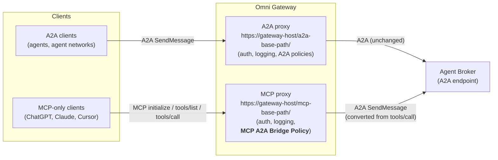
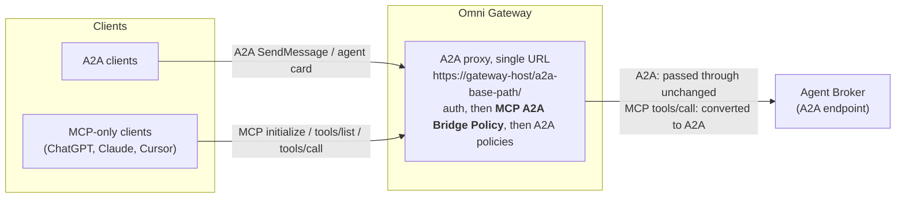

# MCP A2A Bridge Policy

A custom Omni Gateway (Flex Gateway) policy that lets MCP clients use an A2A agent broker, such as a MuleSoft Agent Broker, as if it were an MCP server.

| | |
|---|---|
| Exchange asset | `mcp-a2a-bridge-policy` (definition), `mcp-a2a-bridge-policy-flex` (implementation) |
| Current version | 1.0.3 |
| Category | Transformation |
| Applies to API instance types | MCP, A2A (v0.3), A2A (v1.0) |
| Gateway | Omni Gateway / Flex Gateway (managed or self-managed) |

---

## 1. Purpose

The policy turns an A2A agent broker into an MCP server with a single tool (`ask_agent` by default). MCP clients find the tool, call it with a natural-language question, and get the broker's answer back as an ordinary MCP tool result. The broker itself needs no changes.

## 2. Problem statement

- **Agent brokers speak only A2A.** A MuleSoft Agent Broker accepts A2A requests (`SendMessage`, tasks, agent card).
- **Many AI clients speak only MCP.** ChatGPT, Claude, Cursor and Copilot connect to MCP servers. They can't call an A2A endpoint.
- **The two protocols differ.** They use different messages, different conversation handling (A2A context and task IDs versus MCP tool calls), and different response shapes.

Without the policy, every team that wants these clients to reach the broker has to build and run its own MCP wrapper service. The policy does the conversion inside the gateway instead, alongside the existing security, logging and rate-limiting policies, and needs no extra service.

## 3. How it works

| MCP client sends | Policy does |
|---|---|
| `initialize`, `ping`, `tools/list`, notifications | Answers them at the gateway; nothing reaches the broker |
| `tools/call` for `ask_agent` | Converts the call into an A2A `SendMessage`, forwards it to the broker, and converts the A2A reply back into an MCP tool result |
| Native A2A request (Mode 2 only) | Forwards it to the broker unchanged |

**Multi-turn conversations.** Every tool result returns the broker's `contextId`, `taskId` and `state`.
- To **continue a conversation**, the client passes `context_id` back.
- To **answer a question the broker asked** (state `input-required`), the client passes `context_id` and `task_id`.

---

## 4. Deployment modes

### Mode 1: separate MCP proxy next to the A2A proxy

The broker keeps its existing A2A proxy. A second API instance of type **MCP** points to the same broker, and the policy is applied **only on the MCP proxy**. A2A clients and MCP clients each use their own URL.



- **When to use:** you want separate URLs, policies, contracts and analytics for MCP and A2A traffic. This is the recommended setup.
- **Key settings:** `passThroughA2A: false`. Use `a2aPath: "/"` so MCP clients can call either `<mcp-base-path>/` or `<mcp-base-path>/mcp`.

### Mode 2: one proxy for both A2A and MCP clients

Only the broker's A2A proxy exists, and the policy is applied **directly on that A2A proxy**. A2A clients and MCP clients use the **same URL**.



How the policy decides what to do with each request:
1. **The request is MCP**, for example `initialize`, `tools/list` or `tools/call`. The policy answers it itself or converts it, as in section 3.
2. **The request is native A2A**, for example `SendMessage` or the agent card. With `passThroughA2A: true`, the policy forwards it to the broker untouched.

- **When to use:** you want a single endpoint for every client, or you can't create a second API instance.
- **Key settings:** `passThroughA2A: true` and `a2aPath` left empty. MCP clients call the A2A base URL, with the trailing slash.
- **Policy order:** put the bridge **after** authentication policies (client ID, OAuth/OIDC) and **before** A2A-specific policies (A2A schema validation, A2A PII detection). Those A2A policies then see the converted A2A message.

---

## 5. Configuration properties

| Property | Required | Default | Description | Sample value |
|---|---|---|---|---|
| `toolName` | Yes | `ask_agent` | Name of the MCP tool shown to clients. Letters, digits, `_` and `-`; up to 64 characters. | `ask_hr_agent` |
| `toolDescription` | No | Generic description | Text the client's AI model reads to decide when and how to call the tool. **This is the most important setting for answer quality** (see 5.1). | `Ask the <Org> <Domain> agent network about <topics>. HOW TO CALL: (1) ... (2) ... (3) ...` |
| `serverName` | No | `mcp-a2a-bridge` | Server name returned to MCP clients during the handshake. | `<org>-hr-assistant` |
| `serverInstructions` | No | empty | Short usage instructions returned during the handshake. Not every client uses them. | `Use ask_agent. Reuse context_id for follow-ups and restate the subject in full.` |
| `a2aProtocolVersion` | Yes | `1.0` | A2A version the broker uses: `1.0` or `0.3`. | `1.0` |
| `passThroughA2A` | No | `false` | `false`: accept MCP traffic only (Mode 1). `true`: also forward native A2A traffic unchanged (Mode 2). | Mode 1: `false` / Mode 2: `true` |
| `a2aPath` | No | empty | Path on the upstream (broker) URL that converted calls are sent to. Empty forwards the path the client used. `/` sends every call to the broker's root URL. | Mode 1: `/` / Mode 2: empty / custom: `/<a2a-sub-path>` |
| `includeStructuredContent` | No | `true` | Adds `contextId`, `taskId` and `state` to each tool result. Keep it on so clients can hold multi-turn conversations. | `true` |
| `sessionStoreMode` | No | `disabled` | Optional gateway-side memory of the last conversation per MCP session, for clients that never send `context_id` back. `local` keeps it in memory on each gateway replica; `remote` needs gateway Shared Storage (Redis). | `disabled` |
| `sessionTtlSeconds` | No | `1800` | How long, in seconds, a remembered conversation lasts (60–86400). Used only with a session store. | `1800` |
| `sessionKeyHeader` | No | empty | Request header whose value is mixed into the session key, so a remembered conversation is tied to the caller. Used only with a session store. | `client_id` |

### 5.1 Writing a good `toolDescription`

The broker doesn't remember earlier answers across separate questions. The description should therefore tell the client's AI model:
1. **What the agent covers**, for example the domains and agents behind the broker.
2. **New topic:** send only the message.
3. **`input-required`** (the broker asked a question): reply with the same `context_id` **and** `task_id`.
4. **Follow-up after a completed answer:** send the same `context_id`, with no `task_id`, and **restate the subject in full** (names, IDs, record numbers). For example, write "What is Jane Doe's email?" rather than "What is her email?".
5. **Never invent IDs.**

The API Manager form shows this field on a single line, so write the rules inline: `(1) ... (2) ... (3) ...`.

### 5.2 Recommended policy order

| Order | Mode 1: MCP proxy | Mode 2: A2A proxy |
|---|---|---|
| 1 | Logging / tracing (optional) | Agent card, logging, tracing (existing) |
| 2 | OAuth 2.0 Protected Resource Metadata (if you use OAuth) | Authentication (Client ID enforcement / OIDC) |
| 3 | Authentication (OIDC access token or Client ID enforcement) | **MCP A2A Bridge Policy** |
| 4 | **MCP A2A Bridge Policy** | A2A policies (PII detection, schema validation) |
| 5 | Response timeout (recommended: 120 s) | |

- **Authentication must run before the bridge.** The bridge answers `initialize` and `tools/list` itself, so any policy placed after it never runs for those requests.
- **Raise the response timeout.** Questions that span several systems can take 30–60 s, and the default MCP timeout is shorter.

---

## 6. Endpoints to share with clients

| Mode | Client | URL |
|---|---|---|
| Mode 1 | MCP clients | `https://<gateway-host>/<mcp-base-path>/` or `https://<gateway-host>/<mcp-base-path>/mcp` |
| Mode 1 | A2A clients | `https://<gateway-host>/<a2a-base-path>/` |
| Mode 2 | MCP and A2A clients | `https://<gateway-host>/<a2a-base-path>/` (trailing slash required) |

- **Clients that can't send custom headers** (ChatGPT, for example) can't pass `client_id` and `client_secret`, so protect the endpoint with OAuth 2.0. Apply the OAuth 2.0 Protected Resource Metadata policy and an OIDC access token policy.
- **Registering the proxy as an MCP asset in Exchange:** the tool definition (`ask_agent`, with inputs `message`, `context_id` and `task_id`) can be published in the MCP schema.

---

## 7. Publishing the policy to Anypoint Exchange

The policy has two parts, each with its own folder. **Publish the definition first, then the implementation.**

```
mcp-a2a-bridge-policy/
├── mcp-a2a-bridge-policy-definition/   # configuration schema: exchange.json, gcl.yaml
└── mcp-a2a-bridge-policy-flex/         # implementation: Cargo.toml
```

### 7.1 Prerequisites
- **Anypoint CLI v4** with the PDK plugin (`anypoint-cli-v4 plugins:install anypoint-pdk-plugin`), plus the Rust toolchain. For first-time setup, run `make setup` in the implementation folder.
- **A connected app** (client credentials) with the **Exchange Contributor** permission in the target business group.

### 7.2 Set the target business group and version

**`mcp-a2a-bridge-policy-definition/exchange.json`**
```json
{
  "groupId": "<business-group-id>",
  "assetId": "mcp-a2a-bridge-policy",
  "version": "<x.y.z>"
}
```

**`mcp-a2a-bridge-policy-flex/Cargo.toml`**
```toml
[package]
name = "mcp_a2a_bridge_policy"
version = "<x.y.z>"                       # same version as exchange.json

[package.metadata.anypoint]
group_id = "<business-group-id>"          # same as groupId in exchange.json
definition_asset_id = { name = "mcp-a2a-bridge-policy", version = "<x.y.z>" }
implementation_asset_id = "mcp-a2a-bridge-policy-flex"
```

- **Versions must match.** Use the same `<x.y.z>` in all three places.
- **Released versions are permanent.** Exchange won't overwrite a released version, so bump the version for every change.

### 7.3 Credentials (environment variables)
```bash
export ANYPOINT_CLIENT_ID=<connected-app-client-id>
export ANYPOINT_CLIENT_SECRET=<connected-app-client-secret>
export ANYPOINT_ORG=<business-group-id>
```

### 7.4 Publish

| Command | Folder | Result |
|---|---|---|
| `make release` | `mcp-a2a-bridge-policy-definition` | Publishes the definition as version `<x.y.z>` |
| `make release` | `mcp-a2a-bridge-policy-flex` | Builds the policy and publishes the implementation as version `<x.y.z>` |
| `make publish` | either folder | Publishes a **development** version (`<x.y.z>-DEV`) for testing. When publishing the implementation this way, set `definition_asset_id` version to `<x.y.z>-DEV`. |

```bash
cd mcp-a2a-bridge-policy-definition && make release
cd ../mcp-a2a-bridge-policy-flex   && make release
```

### 7.5 Verify
1. **Exchange:** in the business group, both `mcp-a2a-bridge-policy` and `mcp-a2a-bridge-policy-flex` show version `<x.y.z>`.
2. **API Manager:** open an MCP or A2A API instance, then Policies → Add policy. **MCP A2A Bridge Policy** appears under **Transformation**.
