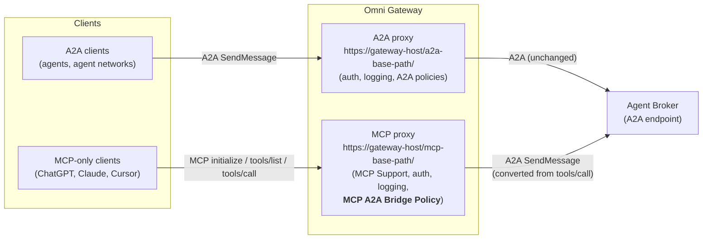
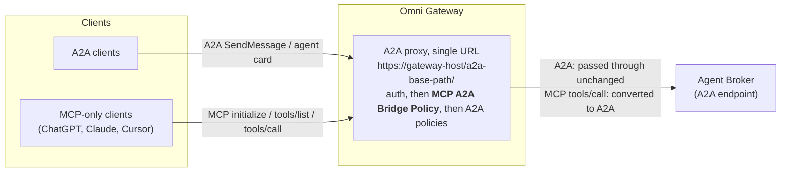

# MCP A2A Bridge Policy

A custom Omni Gateway (Flex Gateway) policy that lets MCP clients use an A2A agent, such as a MuleSoft Agent Broker, as if it were an MCP server with one tool.

| | |
|---|---|
| Exchange asset | `mcp-a2a-bridge-policy` (definition), `mcp-atoa-bridge-policy-flex` (implementation) |
| Version | 1.4.0 (adds optional Agent Card discovery, issue #16; 1.3.3 was the original release) |
| Category | Transformation |
| Applies to API instance types | MCP, A2A (v0.3), A2A (v1.0) |
| Gateway | Omni Gateway / Flex Gateway (managed or self-managed), **1.11.0 or later** for policy 1.1.0 and later |

**What's new in 1.4.0 (issue #16):** optional discovery metadata from the upstream Agent Card (`metadataMode: agent-card`, section 5.4). The default, `manual`, behaves exactly like 1.3.3 and never fetches the card; existing configurations need no change. Verified on 2026-11-17: 161 unit tests, a managed Omni Gateway (agent-card and manual instances side by side) and a Flex Gateway 1.11.0 in Connected mode (card change, malformed card, outage, stale window and recovery). See [Agent Card discovery verification](P4A-Issue-Resolutions.md#issue-16-agent-card-derived-mcp-discovery).

This guide describes the integrated PR15 tree combining commits `9226547` + `dc7e00d`, verified on 2026-11-16 before the final merge commit. `make test` passed 146 unit tests and one Docker integration test; `make test-shared-storage` passed 46 checks including both official MCP SDK clients (log `pr15-integrated-shared-storage.log`). Definition validation, formatting, host clippy and WASM clippy passed. These Local Mode results are not a claim of publication, server-side PR merge, managed-gateway testing or live configuration migration. See [the evidence](P4A-Issue-Resolutions.md#nov-16-follow-up-2026-11-16).

**PR14 history, verified 2026-11-16:** its Nov 16 worktree based on source HEAD `e1b5d0921c158922abc0d71e057ca46fbb7cc18c` passed `make build`, formatting, clippy, 70 unit tests and one Docker integration test on Flex 1.11.0. The prior-session shared-storage run passed 18 checks on two Flex 1.11.0 replicas with Redis. This verifies the separate PR14 worktree, not the integrated PR15 tree. Managed-gateway testing and live configuration migration were not run. See [verification details](P4A-Issue-Resolutions.md#nov-16-follow-up-verification).

---

## 1. Purpose

The policy puts an MCP front on an A2A agent. The agent can be a single A2A agent or an agent broker such as MuleSoft Agent Broker; this guide says "broker" for either. MCP clients see one tool (`ask_agent` by default), call it with a natural-language message, and get the agent's answer back as an ordinary MCP tool result. The agent needs no changes for client-managed conversations; experimental elicitation requires the upstream safety marker described in 3.2.

It is a **single-tool adapter**, not a full or lossless MCP↔A2A protocol translation. Each `tools/call` becomes one A2A `SendMessage`, and the policy returns the final or interrupted result. Polling, cancel, push notifications, streaming delivery and authentication flows are not mapped, MCP elicitation is an experimental opt-in (3.2), and some artifact detail is flattened. Read [section 8, Limitations](#8-limitations) before relying on it.

## 2. Problem statement

- **Agent brokers speak only A2A.** A MuleSoft Agent Broker accepts A2A requests (`SendMessage`, tasks, agent card).
- **Many AI clients speak only MCP.** ChatGPT, Claude, Cursor and Copilot connect to MCP servers. They can't call an A2A endpoint.
- **The two protocols differ.** They use different messages, different conversation handling (A2A context and task IDs versus MCP tool calls), and different response shapes.

Without the policy, every team that wants these clients to reach the broker has to build and run its own MCP wrapper service. The policy does the conversion inside the gateway instead, alongside the existing security, logging and rate-limiting policies, and needs no extra service.

## 3. How it works

| MCP client sends | Policy does |
|---|---|
| `initialize`, `ping`, `tools/list`, notifications | Answers them at the gateway; nothing reaches the broker |
| `tools/call` for `ask_agent` | Converts the call into an A2A `SendMessage`, forwards it to the broker, and converts the A2A reply back into an MCP tool result |
| Native A2A request (Mode 2 only): JSON-RPC (v1.0 or v0.3), HTTP+JSON (`/message:send`, `/tasks/{id}:cancel`, ...), agent card, gRPC | Forwards it to the broker unchanged: same path, headers and body |

**Multi-turn conversations.** Every tool result returns the broker's `state`, and its `contextId` and `taskId` when the broker sent them.
- To **continue a conversation**, the client passes `context_id` back.
- To **answer a question the broker asked** (state `input-required`), the client passes `task_id`, plus `context_id` when one was returned. A2A v1.0 lets an agent omit the context ID, so `task_id` alone is valid.
- **`auth-required`** means the broker needs authorization that the user must complete outside the conversation, as the broker describes. Replying to the tool doesn't grant it, and the client must never send passwords, tokens or other secrets in `message`. Once it is done, the client calls the tool again with the same IDs.

The tool result text always says what to do next, even with `includeStructuredContent: false`.

### 3.1 Client-managed follow-up questions

This is the default, and the mode to use with ChatGPT. The policy never asks the user anything itself: it doesn't send MCP `elicitation/create` or any other server-to-client request, and it never resubmits a task on its own. The MCP client owns the conversation. It shows the broker's question to the user, collects the answer, and calls the tool again with the IDs.

1. The client calls the tool:
   ```json
   {"jsonrpc":"2.0","id":1,"method":"tools/call",
    "params":{"name":"ask_agent","arguments":{"message":"Pay the electricity bill"}}}
   ```
2. The broker needs more input. The policy returns the question, the state and the continuation:
   ```json
   {"jsonrpc":"2.0","id":1,"result":{
     "content":[
       {"type":"text","text":"Which account should I use?"},
       {"type":"text","text":"[a2a state=input-required] The agent is waiting for your reply. Call ask_agent again with task_id=\"t9\"."}],
     "structuredContent":{"state":"input-required","taskId":"t9"},
     "isError":false}}
   ```
   In this example the broker sent no `contextId`. When it does, the hint and `structuredContent` include it, and the client passes it back too.
3. The client asks the user, then sends the answer to the same task:
   ```json
   {"jsonrpc":"2.0","id":2,"method":"tools/call",
    "params":{"name":"ask_agent","arguments":{"message":"The checking account","task_id":"t9"}}}
   ```
4. The broker continues task `t9` and the policy returns its next result: `completed`, or another `input-required` that the client handles the same way.

### 3.2 Experimental: MCP elicitation (`enableElicitation`)

Off by default. **Leave it off for ChatGPT**, which doesn't support MCP elicitation; the client-managed mode in 3.1 is what ChatGPT uses, and it is unchanged when this setting is on.

When `enableElicitation` is `true`, the policy asks the user the broker's question itself, through the MCP client's form, but only when all of these hold:
- a session store is configured (`sessionStoreMode` `local` or `remote`). Use `remote` whenever the gateway has more than one replica, which is always the case on a managed Omni Gateway (5.3);
- the client negotiated MCP `2025-06-18` or later and declared `capabilities.elicitation` at `initialize`;
- the `tools/call` accepts `text/event-stream`;
- the broker answered `input-required` with a task ID and the boolean `Task.metadata["p4a.elicitationSafe"]` set to `true` for this question. `auth-required` is never turned into a form;
- there is no open or retained completed elicitation stream that would be replaced.

Otherwise the call behaves exactly as in 3.1.

**Trusted upstream contract.** Enable this only for an upstream you trust to mark non-sensitive questions. For example, a safe task carries `"metadata": {"p4a.elicitationSafe": true}`. Every subsequent `input-required` question must opt in again; a streamed status update must carry its own marker, rather than inherit a previous question's approval. A missing or `false` marker returns the question as a client-managed tool result. A non-boolean marker or malformed metadata is an invalid upstream response, not an opt-in. The bridge does not detect secrets in arbitrary question text: the warning on the form and the upstream marker are not a guarantee that a marked question cannot request sensitive information. Never mark credential or authorization questions safe, and never enter passwords, tokens or other secrets in the form or a follow-up message.

How it works. A gateway policy can't hold a response open while the user thinks, so the question travels on a short SSE stream that the client resumes, as Streamable HTTP allows:
1. The `tools/call` response is an SSE stream with one `elicitation/create` request (event `id: <stream>-1`) and a `retry` hint, and then the stream ends. The form has one required text field, `answer`, and tells the user never to enter passwords, tokens or other secrets.
2. The client POSTs its JSON-RPC response to that request and gets `202`. An accepted answer is sent to the broker as the next message of the same task, with its `taskId` and `contextId`.
3. The client reconnects with `GET` and `Last-Event-ID`. It receives the broker's next question on the same stream, or the `tools/call` result under the original request ID. Until the broker has answered, the stream only carries the `retry` hint.

| Event | What happens |
|---|---|
| **Accept** | The answer goes to the broker. Its reply is the next question, or the result. |
| **Decline or cancel** | The question's conversation ends: the result says so (`structuredContent: {"state":"ended","reason":"declined"}` or `"cancelled"`). Its remembered context/task are cleared only if it still owns the session generation; a newer independent conversation is preserved. |
| **No answer in time, or the client disconnects and never comes back** | An unanswered question expires after `elicitationTimeoutSeconds` (default 300), ending with `reason: "timeout"` and `isError: true`. A late answer is ignored. Once an answer has been accepted, this input deadline no longer times it out; the upstream response timeout applies. |
| **The client answers with a JSON-RPC error** (for example it can't show the form) | The question is returned as an ordinary `input-required` result with the IDs, and the conversation continues the 3.1 way. |
| **More than `maxElicitationRounds` questions** (default 3) | The extra question is returned as an ordinary `input-required` result with the IDs. |
| **A subsequent question without the safe marker** | It is returned as an ordinary `input-required` result with the IDs, even if an earlier question was marked safe. |
| **A new `tools/call` while a question is open** | A call that would continue the waiting conversation gets a tool error asking the user to answer or cancel first; the question and its stream stay open. An independent call (`new_conversation: true`, or other explicit IDs) runs normally, without a form. |
| **A new question while a completed stream is retained** | Completed results remain replayable for `sessionTtlSeconds` after settlement, even if already fetched. The new question is client-managed during that window so it cannot replace the old stream's result. |
| **`notifications/cancelled` for the call** | The question is ended and its context cleared if it still owns the session generation; a newer independent conversation is preserved. |

Answers and resumed streams are bound to the session and its `sessionKeyHeader` identity, and only the current question's ID is accepted. A CAS claim forwards an answer at most once; this is not a guarantee of delivery if forwarding fails. Continuation, call generation and pending state share one atomic session entry. Transitions re-read that entry and check generation plus stream/round ownership as applicable before CAS, so stale replies or cancellations cannot overwrite a newer conversation.

**Persistence failure and processing recovery.** CAS updates make at most three attempts. If an answer claim or result settlement still needs persistence after those attempts fail, the answer leg returns `503` rather than `202`; stream timeout/recovery persistence can also return `503`. A duplicate whose state already advanced can still get `202` without forwarding. Do not blindly resend an accepted answer after `503`: upstream action may already have happened. Acceptance moves the question to `Answering` with a separate processing/recovery deadline of 1800 seconds, not the original input deadline. The upstream response timeout still governs the upstream request. If resumption finds `Answering` unresolved after the recovery deadline, it attempts to settle a tool error telling the client to start a new call and **not resend the accepted answer**; failure to persist that recovery returns `503`. This is recovery from missing persisted completion, not an input timeout or upstream retry.

**Remembered conversation.** With a session store, a call without `context_id` continues the conversation remembered for the MCP session, so asking the same question again in the same session may get an answer straight away instead of a form. To start over, pass `new_conversation: true` (the tool advertises this argument only when a session store is configured), or reconnect to get a new session.

This mode is **experimental**. It needs a client that supports elicitation and `Last-Event-ID` resumption. Test it with your target client (9) before you turn it on.

---

## 4. Deployment modes

### Mode 1: separate MCP proxy next to the A2A proxy

The broker keeps its existing A2A proxy. A second API instance of type **MCP** points to the same broker, and the policy is applied **only on the MCP proxy**. A2A clients and MCP clients each use their own URL.



- **When to use:** you want separate URLs, policies, contracts and analytics for MCP and A2A traffic. This is the recommended setup.
- **Key settings:** `passThroughA2A: false`, with MCP Support first in the policy order (5.2). Use `a2aPath: "/"` so MCP clients can call either `<mcp-base-path>/` or `<mcp-base-path>/mcp`.

### Mode 2: one proxy for both A2A and MCP clients

Only the broker's A2A proxy exists, and the policy is applied **directly on that A2A proxy**. A2A clients and MCP clients use the **same URL**.



How the policy decides what to do with each request:
1. **The request is MCP**, for example `initialize`, `tools/list` or `tools/call`. The policy answers it itself or converts it, as in section 3.
2. **The request is native A2A**, for example a `SendMessage` or `message/send` JSON-RPC call, an HTTP+JSON call such as `POST /message:send`, or the agent card. With `passThroughA2A: true`, the policy recognises it before any MCP handling and forwards it to the broker untouched. It does not add or change the `A2A-Version` header, the path or the body, and the broker's response goes back unchanged.

Only translated `tools/call` requests are changed. Their version follows the configured `a2aProtocolVersion`: `1.0` sets the `A2A-Version` header to `1.0`, and `0.3` removes it. Both remove all `A2A-Version` query parameters, including percent-encoded names, while preserving unrelated query parameters.

- **When to use:** you want a single endpoint for every client, or you can't create a second API instance.
- **Key settings:** `passThroughA2A: true` and `a2aPath` left empty. MCP clients call the A2A base URL, with the trailing slash.
- **Policy order:** put the bridge **after** authentication policies (client ID, OAuth/OIDC) and **before** A2A-specific policies (A2A schema validation, A2A PII detection). Those A2A policies then see the converted A2A message.

---

## 5. Configuration properties

| Property | Required | Default | Description | Sample value |
|---|---|---|---|---|
| `toolName` | Yes | `ask_agent` | Name of the MCP tool shown to clients. Letters, digits, `_` and `-`; up to 64 characters. | `ask_hr_agent` |
| `toolDescription` | No | Generic description | Text the client's AI model reads to decide when and how to call the tool. **This is the most important setting for answer quality** (see 5.1). | `Ask the <Org> <Domain> agent network about <topics>. HOW TO CALL: (1) ... (2) ... (3) ...` |
| `serverName` | No | `mcp-a2a-bridge` | Server name returned to MCP clients during the handshake. | `<org>-hr-assistant` |
| `serverInstructions` | No | empty | Short usage instructions returned during the handshake. Not every client uses them. | `Use ask_agent. Reuse context_id for follow-ups and restate the subject in full.` |
| `a2aProtocolVersion` | Yes | `1.0` | A2A version the broker uses: `1.0` or `0.3`. | `1.0` |
| `passThroughA2A` | No | `false` | `false`: accept MCP traffic only (Mode 1). `true`: also forward native A2A traffic unchanged (Mode 2). | Mode 1: `false` / Mode 2: `true` |
| `a2aPath` | No | empty | Path on the upstream (broker) URL that converted calls are sent to. Empty forwards the path the client used. `/` sends every call to the broker's root URL. Native A2A traffic is never rewritten. | Mode 1: `/` / Mode 2: empty / custom: `/<a2a-sub-path>` |
| `includeStructuredContent` | No | `true` | Adds `state`, plus `contextId` and `taskId` when present, to each tool result. The text always includes the continuation hint, but keep this on so clients can read the IDs reliably. | `true` |
| `sessionStoreMode` | No | `disabled` | Optional gateway-side memory of the last conversation per MCP session, for clients that never send `context_id` back. `local` keeps it in memory on each gateway replica; `remote` uses the gateway's shared storage, so every replica sees it (5.3). Required for elicitation. | `remote` |
| `sessionTtlSeconds` | No | `1800` | Logical idle lifetime in seconds after a stored conversation transition (60–86400), and the completed-stream replay window. `tools/list`, `ping` and resumed streams don't extend it. Open questions retain state through their deadline plus this TTL. Retention namespace changes require reinitialization (below). | `1800` |
| `sessionKeyHeader` | No | empty | Request header whose value is mixed into the session key, so a remembered conversation is tied to the caller. When set, this is enforced: a request without the header gets no session and can't use or end one. Used only with a session store. | `client_id` |
| `enableElicitation` | No | `false` | **Experimental.** Ask only trusted upstream-marked safe `input-required` questions through MCP elicitation (3.2). Needs a session store and a client that declared elicitation. Leave it off for ChatGPT. | `false` |
| `elicitationTimeoutSeconds` | No | `300` | How long the user has to answer each elicited question (30–1800, independent of `sessionTtlSeconds`). Once accepted, the answer waits under the upstream response timeout instead. | `300` |
| `maxElicitationRounds` | No | `3` | Questions asked through elicitation per `tools/call` (1–10). A further question is returned as an ordinary tool result with the IDs. | `3` |
| `metadataMode` | No | `manual` | Where the discovery metadata comes from (5.4). `manual` advertises `toolDescription` and `serverName` as configured and never fetches anything. `agent-card` builds the tool description and `serverInfo.title` from the upstream Agent Card. | `agent-card` |
| `agentCardUrl` | With `agent-card` | empty | Full URL of the agent's own card, reached directly (not through this API's public URL). | `https://<broker-host>/.well-known/agent-card.json` |
| `agentCardAuthorization` | No | empty | `Authorization` header value for a card that requires authentication. Stored as a sensitive value. | `Bearer <token>` |
| `agentCardRefreshSeconds` | No | `300` | How often each gateway worker refreshes the card (30–86400). A failed fetch is retried after 30 s, or sooner if this is lower. | `300` |
| `agentCardMaxStaleSeconds` | No | `3600` | How long a cached card may still be used after refreshes start failing, on top of the refresh period (0–604800). | `3600` |
| `agentCardTimeoutSeconds` | No | `5` | Timeout of one card fetch (1–30). | `5` |

**Limits, sessions and protocol checks**
- **Gateway version.** 1.1.0 and later need Flex Gateway **1.11.0 or later**. It reads the request body before choosing which headers to change, and Flex 1.10.x doesn't support that: the gateway logs `FlexAbiHandler: command 'flex_enable_stop_iteration' unknown` and doesn't start the API. Stay on policy 1.0.x until the gateway is upgraded.
- **Response size.** The gateway can't write a body of 1 MB or more. If a converted answer would be too large, the policy first drops `structuredContent.data` (data parts are also in the text), then truncates the answer text with a note, and as a last resort returns a tool error. The client always gets a valid MCP result, never the raw A2A reply. The remembered conversation is updated only after the answer is delivered. A `tools/call` message too large to forward gets error `-32602`.
- **Sessions.** `Mcp-Session-Id` values are random UUIDs, issued at `initialize` and registered in the store. A request with an `Mcp-Session-Id` that isn't a live session of the same caller gets HTTP `404` (JSON-RPC `-32001`, "Session not found"), as the MCP transport requires. That covers IDs that were never issued, have expired, were ended with `DELETE`, or belong to another identity. The client should then call `initialize` again. Without a session store the header is ignored. Store keys are a SHA-256 hash of the API/policy scope, session ID and identity. The store namespace is specific to the API instance and policy, so two APIs that share one Redis don't share sessions, while replicas of the same API do.
- **Retention and upgrades (PR #15).** Continuation, generation and pending elicitation share a single CAS-protected entry in `mcp-a2a-sessions-v2/<api-id>/<policy-name>.<policy-namespace>/retention-<seconds>` (base path substitutes for the API ID in local mode). Remote physical retention is `sessionTtlSeconds + 1800` when elicitation is enabled, and `sessionTtlSeconds` otherwise. This does not extend ordinary logical idle expiry. An open question retains state through its deadline plus a replay window of `sessionTtlSeconds`; a completed stream is retained for that TTL after settlement. Upgrading from the old namespace or changing `sessionTtlSeconds` or `enableElicitation` so that physical retention changes selects a different namespace: existing session IDs are not migrated and clients must `initialize` again. Roll out consistent configuration across replicas.
- **Termination.** `DELETE` returns `204` only after a checked CAS writes a tombstone clearing continuation and pending state. An unknown or other caller's session gets `404`; a failed termination write gets `503`, which the client should retry rather than assume termination succeeded. A late response cannot revive a successfully terminated session. Session updates re-read current state and validate generation/ownership before CAS, rather than use a CAS token saved when the request began.
- **Content encoding.** Rewritten responses remove `Content-Encoding` because the new JSON/SSE bytes are uncompressed. The bridge does not decompress compressed upstream bodies; configure uncompressed upstream JSON/SSE for translated calls. Native A2A pass-through headers and bodies are unchanged.
- **Version query cleanup.** For translated calls, query keys are percent-decoded exactly once before case-insensitive matching of `A2A-Version`; matching parameters are removed. Other parameters are preserved, not recursively decoded.
- **Protocol checks (1.3.0).**
  - Messages must be JSON-RPC 2.0 with a string or integer `id` and object `params`. Invalid messages are rejected before anything reaches the broker.
  - `initialize` needs `protocolVersion`, `capabilities` and `clientInfo`. A well-formed version the policy doesn't support gets the latest supported version (`2025-06-18`) in reply.
  - After `initialize`, an `MCP-Protocol-Version` header that isn't `2025-06-18`, `2025-03-26` or `2024-11-05` gets HTTP `400`. A missing header is accepted.
  - Notifications and client responses get `202` with no body.
  - Negotiating `2024-11-05` doesn't add that revision's legacy HTTP+SSE transport. The policy only offers Streamable HTTP (POST).
- **Broker answers (1.3.0).**
  - The broker's answer must be a JSON-RPC 2.0 response with the same `id` as the request and a valid Task or Message. Anything else becomes a tool error ("The A2A agent returned an invalid response") and nothing from it is remembered. Result payloads and parts must have exactly one supported variant (oneof); every history message is validated even when newer status or artifact content supplies the answer. Artifacts require a non-empty `artifactId`; streamed status/artifact updates require non-empty `taskId` and `contextId`, consistently correlated across the stream. A v1.0 data part may contain any JSON value, including `null`; a v0.3 `kind: "data"` part requires an object.
  - SSE streams are parsed by the SSE rules (LF, CRLF or CR line endings, an optional BOM, comments). Artifact updates replace the earlier artifact with the same `artifactId` unless `append` is `true`.
  - A corrupt or cut-off stream is a tool error, not a partial answer.

### 5.1 Writing a good `toolDescription`

The broker doesn't remember earlier answers across separate questions. The description should therefore tell the client's AI model:
1. **What the agent covers**, for example the domains and agents behind the broker.
2. **New topic:** send only the message.
3. **`input-required`** (the broker asked a question): reply with the same `task_id`, and the same `context_id` when one was returned.
4. **Follow-up after a completed answer:** send the same `context_id`, with no `task_id`, and **restate the subject in full** (names, IDs, record numbers). For example, write "What is Jane Doe's email?" rather than "What is her email?".
5. **Never invent IDs.**

The API Manager form shows this field on a single line, so write the rules inline: `(1) ... (2) ... (3) ...`.

### 5.2 Recommended policy order

| Order | Mode 1: MCP proxy (managed or connected gateway) | Mode 2: A2A proxy |
|---|---|---|
| 1 | **MCP Support** (required, must be first) | Agent card, logging, tracing (existing) |
| 2 | Logging / tracing (optional) | Authentication (Client ID enforcement / OIDC) |
| 3 | OAuth 2.0 Protected Resource Metadata (if you use OAuth) | **MCP A2A Bridge Policy** |
| 4 | Authentication (OIDC access token or Client ID enforcement) | A2A policies (PII detection, schema validation) |
| 5 | **MCP A2A Bridge Policy** | |
| 6 | Response timeout (recommended: 120 s) | |

- **MCP Support comes first on an MCP instance.** MuleSoft requires the [MCP Support](https://docs.mulesoft.com/gateway/latest/policies-included-mcp-support) policy on every MCP server instance, first in the order. Without it, or with it later in the order, the gateway can throw a runtime error. Mode 2 is an A2A instance, so it doesn't use MCP Support.
- **Local Mode is different.** MCP Support isn't supported in Local Mode. For local tests (the PDK playground and `make test`), apply the bridge without it, after any authentication policy.
- **Authentication must run before the bridge.** The bridge answers `initialize` and `tools/list` itself, so any policy placed after it never runs for those requests.
- **Raise the response timeout.** Questions that span several systems can take 30–60 s, and the default MCP timeout is shorter.

### 5.3 Session store and gateway replicas

| Gateway | Replicas | `sessionStoreMode` | Shared storage |
|---|---|---|---|
| **Managed Omni Gateway (CloudHub)** | Always at least two, across availability zones; Large and Extra Large add more under load. Runtime Manager doesn't show or set a replica count. | `remote` | Built in. The replicas share it with each other, with nothing to configure. |
| **Self-managed, one replica** | One | `local` or `remote` | `local` needs none |
| **Self-managed, several replicas** | Several | `remote` | Configure Shared Storage on every replica: Redis, or the built-in `distributed://` object store |

- **Why `local` fails with several replicas.** Requests are load-balanced across replicas, and each replica's `local` store holds only the sessions it issued. A request that lands on another replica gets `404` "Session not found". On a managed gateway that is most requests: on a three-replica gateway, 33 of 50 `tools/list` calls on one session got `404` with `local`, and 50 of 50 succeeded with `remote`.
- **`remote` without shared storage.** On a self-managed gateway with no Shared Storage configured, PDK stops the policy at startup, so the misconfiguration shows up at deployment rather than at runtime.
- **Historical verification on a managed gateway (released policy 1.3.3, `remote`):** 50 `tools/list` calls on one session, 20 new sessions each used immediately after `initialize`, the client-managed flow (3.1) with and without `context_id`, and an elicitation answered 70 s after the form appeared, while the client resumed the stream about every 2 s across replicas. These are original release results, not verification of the Nov 16 PR #15 changes; current evidence is tracked in [the review resolutions](P4A-Issue-Resolutions.md#nov-16-follow-up-2026-11-16).

### 5.4 Discovery metadata from the Agent Card (`metadataMode`)

By default (`manual`) the tool description and server name are exactly what you configure, and the policy never fetches the Agent Card. With `metadataMode: agent-card` the policy keeps the advertised description in step with the agent's own card.

**Mapping.** It is deterministic and documented here:

| Card field | MCP field | Rule |
|---|---|---|
| `description` | `tools[0].description` | First paragraph. Whitespace and control characters are collapsed into single spaces; capped at 2000 characters. |
| `skills[]` | `tools[0].description` | A `Skills:` list in card order, one line per skill: `name: description` (`id` when there is no `name`). Up to 20 skills, then `(and N more)`; each part capped at 300 characters. |
| (fixed) | `tools[0].description` | Always ends with the instruction to pass back `context_id` and `task_id`. |
| `name` | `serverInfo.title` | Capped at 100 characters. Omitted when the card has no name. |

Nothing else is taken from the card. The tool name, the argument schema, `serverInfo.name` (`serverName`), `instructions` (`serverInstructions`), routing and security never change, so `tools/call` behaves the same whatever the card says, and a client that cached `tools/list` keeps working after the card changes. The policy does not create a tool per skill.

**Precedence.** While a valid card is cached, the card-derived description replaces `toolDescription`. `toolDescription` and the absence of a title are the fallback: they are used before the first successful fetch, when the card is invalid, and after the cache has gone stale beyond the bound. `toolDescription` should therefore still be a good description on its own.

**Fetching and caching.**
- Each gateway worker fetches the card once at startup, in the background, then every `agentCardRefreshSeconds`. Requests never fetch the card and never wait for it, so there is a single refresh in flight per worker and no extra latency on `initialize` or `tools/list`.
- A failed fetch (timeout, non-200 status, a body that is not a JSON object, larger than 256 KB, or with neither a description nor a described skill) keeps the previous card and is retried after 30 s. A card older than `agentCardRefreshSeconds + agentCardMaxStaleSeconds` is dropped and the manual metadata is advertised until a fetch succeeds. The policy never advertises an empty description.
- The cache holds one card per policy instance, in that instance's memory. Two APIs, or two policy instances, never share a card.

**Multiple replicas and workers.** Each worker on each replica keeps its own copy, so for up to one refresh period after the card changes, different replicas can advertise different descriptions. Only the description and title can differ; the tool contract is identical, and `capabilities.tools.listChanged` stays `false`. Expect about one fetch per worker per refresh period from every replica, and size `agentCardRefreshSeconds` for that.

**Authenticated cards.** If the agent protects its card, set `agentCardAuthorization` to the full header value, for example `Bearer <token>` or `Basic <credentials>`. It is sent only to `agentCardUrl`. A static token must outlive the deployment; the policy does not obtain or refresh tokens. Prefer a card that can be read without credentials on the internal network.

**Operating notes.**
- **Card URL.** Use an address the gateway can reach directly, normally the agent's internal URL (for example the upstream service address of the broker's API instance followed by `.well-known/agent-card.json`). The public URL of an API protected by Client ID enforcement needs `client_id`/`client_secret` headers, which the policy does not send.
- **Startup.** The first fetch happens as soon as the policy loads; until it completes (normally well under a second), `tools/list` returns `toolDescription`.
- **Logs.** A failed refresh logs `Agent Card refresh failed: <reason>` (for example `status 504` or `card is not JSON`) as a warning. When the cache passes its bound, the policy logs `Cached Agent Card is too old; advertising the manual metadata.`
- **Turning it off.** Set `metadataMode` back to `manual` (or remove it). The cache and the background fetch go away with the policy update.

**Trust.** Point `agentCardUrl` at the agent itself, an upstream you trust, not at a public URL that clients control. Card text is treated as untrusted display data: it only reaches the client's model as description text, it is flattened so it can't add structure, and it never grants access, changes routing or overrides gateway policies. A card that tells the model to do something is still only a description, so review the card as you would review `toolDescription`.

---

## 6. Endpoints to share with clients

| Mode | Client | URL |
|---|---|---|
| Mode 1 | MCP clients | `https://<gateway-host>/<mcp-base-path>/` or `https://<gateway-host>/<mcp-base-path>/mcp` |
| Mode 1 | A2A clients | `https://<gateway-host>/<a2a-base-path>/` |
| Mode 2 | MCP and A2A clients | `https://<gateway-host>/<a2a-base-path>/` (trailing slash required) |

- **Clients that can't send custom headers** (ChatGPT, for example) can't pass `client_id` and `client_secret`, so protect the endpoint with OAuth 2.0. Apply the OAuth 2.0 Protected Resource Metadata policy and an OIDC access token policy.
- **Registering the proxy as an MCP asset in Exchange:** the tool definition (`ask_agent`, with inputs `message`, `context_id` and `task_id`) can be published in the MCP schema.

---

## 7. Publishing the policy to Anypoint Exchange

The project uses the PDK single-project layout. The definition (`definition/gcl.yaml`) and the implementation (`src/`) live in one project, and one command publishes both.

```
mcp-a2a-bridge-policy/
├── .project.yaml       # PDK project descriptor
├── Makefile
├── Cargo.toml          # crate and Exchange coordinates
├── definition/gcl.yaml # configuration schema
└── src/                # implementation
```

### 7.1 Prerequisites
- **Flex Gateway 1.11.0 or later** where the policy runs (policy 1.1.0 and later). Tested on 1.11.0, 1.12.0 and 1.13.0. Version 1.10.x can't load it.
- **Anypoint CLI v4** with the PDK plugin (`anypoint-cli-v4 plugins:install anypoint-pdk-plugin`), plus the Rust toolchain. For first-time setup, run `make setup`.
- **A connected app** (client credentials) with the **Exchange Contributor** permission in the target business group.

### 7.2 Set the target business group and version

**`Cargo.toml`**
```toml
[package]
name = "mcp_a2a_bridge_policy"
version = "<x.y.z>"

[package.metadata.anypoint]
group_id = "<business-group-id>"
definition_asset_id = "mcp-a2a-bridge-policy"
implementation_asset_id = "mcp-atoa-bridge-policy-flex"
```

- **One version for both assets.** The definition and the implementation are published with the `version` in `Cargo.toml`.
- **Released versions are permanent.** Exchange won't overwrite a released version, so bump the version for every change.
- **Implementation asset ID.** It must not contain digits next to letters. PDK kebab-cases the ID, so `a2a` becomes `a-2-a` and the ID is rejected.

### 7.3 Credentials (environment variables)
```bash
export ANYPOINT_CLIENT_ID=<connected-app-client-id>
export ANYPOINT_CLIENT_SECRET=<connected-app-client-secret>
export ANYPOINT_ORG=<business-group-id>
```

### 7.4 Publish

| Command | Result |
|---|---|
| `make release` | Builds the policy and publishes the definition and implementation as version `<x.y.z>` |
| `make publish` | Publishes a **development** version (`<x.y.z>-DEV`) for testing |

Run either command from the project root.

### 7.5 Verify
1. **Exchange:** in the business group, both `mcp-a2a-bridge-policy` and `mcp-atoa-bridge-policy-flex` show version `<x.y.z>`.
2. **API Manager:** open an MCP or A2A API instance, then Policies → Add policy. **MCP A2A Bridge Policy** appears under **Transformation**.

---

## 8. Limitations

The policy is a single-tool adapter. It covers the common case, where one question gets one answer, possibly with follow-up questions, and these are its limits:

| Area | What the policy does | What it means for you |
|---|---|---|
| **Operations** | Maps `tools/call` to one A2A `SendMessage` (v1.0) or `message/send` (v0.3). Doesn't map `GetTask`, `ListTasks`, `CancelTask`, `SubscribeToTask` or push notification configs. | A task that is still `working` when the call returns can't be polled or cancelled through MCP. Raise the response timeout so most answers finish within one call. |
| **Delivery** | Buffers the broker's answer, including a streamed (SSE) one, and returns one MCP result. | No progress or partial output reaches the client. The answer arrives when the broker finishes (or times out). |
| **Size** | Answers must fit in 1 MB once converted. | Large answers are truncated with a note, or replaced by a tool error. |
| **Content** | Text parts become `content[].text`, and data parts become JSON text plus `structuredContent.data`. A file part becomes a line with its name, media type and URL; inline file bytes are left out. Artifacts are flattened into the text after updates are folded together. | Inline file content, artifact names and metadata, and part metadata are not passed to the client. |
| **Follow-up questions** | By default returns the question, the state and the IDs (`input-required`). Experimental MCP elicitation needs `enableElicitation`, a session store, an elicitation-capable client, SSE acceptance and a fresh upstream boolean safety marker on every question. It asks for one free-text answer. | The client collects the answer and calls the tool again (3.1) when any gate fails or a completed stream is still retained. ChatGPT always works this way. Elicitation (3.2) requires `Last-Event-ID` resumption. The marker is trusted upstream intent, not detection or filtering of secret requests. |
| **Authorization** | Reports `auth-required` with instructions. Doesn't run any authentication flow. | The user completes authorization outside the conversation. Never send secrets in a message. |
| **Bindings and versions** | Translated calls use A2A JSON-RPC, v1.0 or v0.3 (configured). Native HTTP+JSON, JSON-RPC and gRPC are passed through unchanged in Mode 2. MCP revisions 2025-06-18, 2025-03-26 and 2024-11-05, over Streamable HTTP only. | The broker must accept JSON-RPC for translated calls. Clients that need the legacy HTTP+SSE transport (pre-2025-03-26) aren't supported. |
| **Sessions** | Optional gateway memory of continuation, generation and pending elicitation in one v2 entry. `local` is per replica; `remote` is shared. Idle expiry is `sessionTtlSeconds`, with pending-question and completed-stream retention as in section 5. | Use `remote` with several replicas (5.3), or pass IDs explicitly without a store. Idle discovery/ping traffic does not renew the session. The v2 upgrade and retention-changing configuration updates require `initialize` again; physical storage retention is not an idle-lifetime guarantee. |
| **Retries** | Does not retry upstream calls or deduplicate ordinary `tools/call` retries. Session CAS updates retry at most three times; elicitation answer claims are deduplicated. Unpersisted answer claims/settlements return `503` after exhaustion. | A retried `tools/call` may act twice. Do not blindly resend an accepted elicitation answer after `503`: resume its stream, observe recovery, and heed the instruction not to resend. Be careful with agents that take actions (payments, record changes). |
| **Discovery metadata** | `manual` (default) advertises the configured `toolDescription`. `agent-card` derives the description and `serverInfo.title` from the card, cached per worker and refreshed in the background (5.4). One tool only; card skills never become separate tools or typed arguments. | After a card change, replicas can advertise different descriptions for up to one refresh period. `listChanged` notifications are not sent; clients see the new description on their next `tools/list`. Only an `Authorization` header can be sent to a protected card. |
| **Client responsibilities** | Returns interrupted states (`input-required`, `auth-required`, `working`) as normal results with instructions. | The client must show them to the user and continue with the returned IDs. It must not invent IDs, or treat an interrupted result as final. |

## 9. Verification checklist

Run these against the deployed proxy before sharing it with clients.

1. **Policy order.** On an MCP instance (Mode 1), MCP Support is first and authentication comes before the bridge (5.2).
2. **Discovery is protected.** `initialize` and `tools/list` *without* credentials get `401` (or `403`) from the authentication policy, not an MCP result. With valid credentials, `tools/list` returns the bridge tool.
3. **A call reaches the broker.** A `tools/call` with credentials returns `isError: false`, a `state`, and the broker's answer. Check the broker or gateway logs for one `SendMessage`.
4. **Version header.** A request with `MCP-Protocol-Version: 1999-01-01` gets `400`, and the same request with `2025-06-18` succeeds.
5. **Real client continuation.** In the target MCP client (for example Claude, ChatGPT or Cursor), ask something the broker answers with a follow-up question. Answer it in the client, and confirm the broker continues the same task and the client never invents IDs. Then ask a follow-up after a completed answer, and confirm it reuses `context_id`.
6. **Sessions (if enabled).** `initialize` returns `Mcp-Session-Id`. A follow-up with it continues the conversation. A successful `DELETE` returns `204`, after which the same ID gets `404`. A failed termination write returns `503` and must be retried. After the v2 upgrade or a retention-changing configuration update, old IDs get `404` and reinitialization works.
7. **Native A2A (Mode 2 only).** An A2A client's `SendMessage`, and the agent card, still work unchanged on the same URL.
8. **Timeout.** A long multi-agent question completes within the response timeout.
9. **Elicitation (only if `enableElicitation` is on).** Use a trusted broker that marks each safe question with `Task.metadata["p4a.elicitationSafe"]: true`. Confirm the client shows a form, answering continues the same task, and declining ends the conversation. Missing/false markers, including on later questions, must fall back to 3.1; `auth-required` must never elicit. Verify an accepted answer is not input-timed-out while waiting for the broker, a short idle TTL still allows question timeout delivery/replay, and a new question cannot replace a retained completed stream. With ChatGPT, confirm the 3.1 result with `taskId`. For MCP Inspector, first raise its per-server request timeout (server card **Settings** → Timeouts → Request Timeout, while disconnected; default 60 s); Inspector doesn't extend it while the form is open.
10. **Replicas (session store on).** On one session, run 50 `tools/list` calls with the same `Mcp-Session-Id`. All must return `200`; any `404` means the store isn't shared across replicas (5.3).
11. **Agent Card discovery (only if `metadataMode` is `agent-card`).** Within one refresh period of applying the policy, `tools/list` shows the card's description and a `Skills:` list, and `initialize` shows `serverInfo.title` set to the card's name. The tool name, `inputSchema` and `serverInfo.name` are the same as in `manual` mode, and a `tools/call` still succeeds. If the description stays at `toolDescription`, the gateway can't read `agentCardUrl`: check the URL from the gateway's network, the card's authentication, and the gateway log for `Agent Card refresh failed`.
